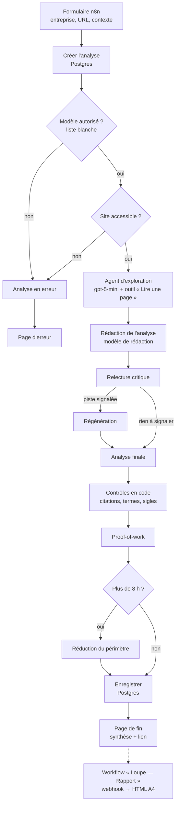

# Loupe

Loupe lit le site d'une entreprise, comprend son produit et sa place sur son marché, puis propose trois pistes de développement et la spécification d'un prototype réalisable en une journée. Le résultat est un rapport A4 de deux ou trois pages, prêt à être imprimé en PDF.

L'ensemble tourne dans [n8n](https://n8n.io) : deux workflows, une base Postgres et des appels à l'API OpenAI.

## Ce que fait une analyse

1. **Exploration** : un agent lit la page d'accueil et choisit trois autres pages utiles (cas clients, produit, aide, tarifs, à propos). Il dresse l'inventaire de ce que le site propose déjà, chaque élément appuyé par une citation exacte.
2. **Rédaction** : un second modèle, configurable, rédige l'analyse à partir du texte des pages lues : synthèse, proposition de valeur, marché, points forts et trois pistes.
3. **Relecture critique** : un appel indépendant signale les pistes qui reprennent l'existant ou qui ajoutent un effort à l'utilisateur ; elles sont régénérées une fois.
4. **Proof-of-work** : la meilleure piste devient la spécification d'un prototype (périmètre, étapes chiffrées en heures, critère de succès). Si le total dépasse 8 h, une seconde passe réduit le périmètre.
5. **Contrôles** : du code vérifie les citations, les termes réglementaires, les sigles, la durée et les traces de révision, et enregistre des avertissements.
6. **Rapport** : la page de fin donne la synthèse et un lien vers le rapport complet, servi par le second workflow.

## Architecture



| Élément | Rôle |
|---|---|
| `workflows/loupe-analyse.json` | Formulaire, exploration, rédaction, relecture, proof-of-work, contrôles (34 nœuds) |
| `workflows/loupe-rapport.json` | Webhook `GET /webhook/loupe-rapport?id=…` qui renvoie le rapport HTML |
| `loupe/prompts/` | Prompts d'exploration, de rédaction, de relecture, de régénération, de proof-of-work et de réduction |
| `loupe/config/` | Liste blanche des modèles avec leurs tarifs, sigles admis par le vérificateur |
| `loupe/sql/` | Schéma `loupe` et ses migrations, appliqués au premier démarrage de la base |
| `loupe/rapport/rapport.js` | Rendu HTML du rapport (CSS d'impression A4) |
| `loupe/tests/` | Script qui relance des analyses et compare coût, durée et avertissements |

## Exemple de rapport

[`loupe/exemples/exemple-anonymise.pdf`](loupe/exemples/exemple-anonymise.pdf) est le rapport d'une vraie analyse, anonymisée par remplacements littéraux : nom de l'entreprise, noms de services, URL, titres de pages et chiffres trop reconnaissables. Les données correspondantes sont dans [`exemple-anonymise.json`](loupe/exemples/exemple-anonymise.json).

> **Synthèse.** Entreprise A met en relation des acheteurs d'appareils reconditionnés avec des reconditionneurs professionnels et propose des services de reprise, de réparation et de remplacement. […] L'opportunité principale consiste à rendre les caractéristiques de chaque appareil plus concrètes et à réutiliser les données de commande pour simplifier sa revente.

| Piste | Impact | Effort |
|---|---|---|
| Présenter le bilan de chaque appareil | fort | fort |
| Clarifier l'alimentation et les accessoires | moyen | moyen |
| Préremplir la reprise depuis les commandes | fort | moyen |

Proof-of-work retenu : « Démonstration de reprise depuis une commande », 7,5 h, en HTML, CSS et JavaScript avec des données fictives.

## Chiffres clés

Mesures faites sur l'instance de développement en octobre 2026, avec gpt-5-mini pour l'exploration et gpt-6.1-sol pour la rédaction.

| Mesure | Valeur |
|---|---|
| Durée d'une analyse | 60 à 136 s sur les quatre dernières analyses |
| Pages lues par analyse | 4 |
| Coût d'une analyse | au moins 0,08 à 0,17 $ (voir la limite ci-dessous) |
| Proof-of-work, premier jet | 7,5 à 14 h, ramené à 8 h au plus par la réduction |
| Rapport imprimé | 2 ou 3 pages A4, vérifié sur 38 analyses |
| Appels au modèle par analyse | 6 à 9, dont plusieurs tours de l'agent d'exploration |

Le coût est un minimum : n8n ne conserve les tokens réellement facturés que pour les appels faits en Chat Completions. Pour les autres, il garde une estimation qui ignore les tokens de raisonnement.

## Installation

Prérequis : Docker avec Compose, et une clé d'API OpenAI donnant accès aux modèles de `loupe/config/modeles.json`.

1. Copier la configuration et la compléter :
   ```bash
   cp .env.example .env
   ```
2. Démarrer n8n et Postgres. Le schéma `loupe` est créé au premier démarrage de la base :
   ```bash
   docker compose up -d
   ```
3. Ouvrir http://localhost:5678 et créer le compte propriétaire.
4. Créer deux credentials dans n8n :
   - **OpenAI** : la clé d'API OpenAI ;
   - **Postgres** : hôte `postgres`, base, utilisateur et mot de passe du fichier `.env`.
5. Importer les deux fichiers de `workflows/` (menu « Import from File »), puis sélectionner les credentials sur les nœuds qui les signalent comme manquants.
6. Activer **Loupe — Rapport** : son webhook sert les rapports.
7. Lancer une analyse :
   - en test : ouvrir **Loupe — Analyse**, cliquer sur « Execute workflow », puis aller sur http://localhost:5678/form-test/loupe-analyse ;
   - en production : activer le workflow, puis utiliser http://localhost:5678/form/loupe-analyse.
8. Facultatif : relancer les exemples et comparer les résultats (workflow actif, `N8N_API_KEY` et `LOUPE_WORKFLOW_ID` renseignés dans `.env`) :
   ```bash
   python3 loupe/tests/lancer.py --modele gpt-5-mini
   ```

Pour changer de modèle, modifier `loupe/config/modeles.json`, puis reporter son contenu dans le nœud « Configuration modèles » du workflow, qui en garde une copie.

## Décisions principales

- **Exploration et rédaction séparées.** Un modèle économique choisit et lit les pages ; un modèle plus capable rédige. Le modèle de rédaction se choisit par analyse, dans une liste blanche avec un plafond de prix en entrée.
- **Contrôles en code plutôt qu'en consignes.** Ce qui peut se vérifier se vérifie hors du modèle : citations retrouvées dans la page source, termes réglementaires et sigles absents des pages, durée du proof-of-work calculée par addition, traces de révision dans le texte final. Les écarts deviennent des avertissements enregistrés avec l'analyse.
- **Une seconde lecture indépendante.** La relecture critique ne voit que les pistes, l'inventaire et le texte des pages, et signale les doublons de l'existant et les pistes qui ajoutent un effort à l'utilisateur. Une piste signalée qui n'a pas pu être régénérée n'est jamais retenue pour le proof-of-work.
- **Des échecs qui restent courts.** L'outil de lecture renvoie « Page inaccessible (404) : non lue » au lieu du contenu d'une page d'erreur, qui pouvait saturer le contexte du modèle. Chaque appel au modèle a une sortie d'erreur ou un repli, et une analyse interrompue est close au démarrage de la suivante.
- **Une réduction limitée.** Quand le prototype dépasse 8 h, la seconde passe ne peut modifier que le périmètre, les étapes et le critère de succès ; le reste est recopié du premier jet.
- **Un rapport HTML imprimable.** Le rapport est une page HTML autonome avec une feuille d'impression A4, sans service de génération de PDF. La densité d'impression a été ajustée pour qu'aucun des 38 rapports mesurés n'ait une dernière page presque vide.
- **Un schéma de données dédié.** Les analyses vivent dans le schéma `loupe`, séparé des tables internes de n8n.

## Limites connues

- L'outil de lecture convertit le HTML en texte avec des expressions régulières : les sites rendus entièrement en JavaScript sont mal lus.
- Le texte de chaque page est tronqué à 15 000 caractères ; une navigation très chargée peut en occuper une bonne part.
- Les avertissements de sigles et de marqueurs de révision donnent quelques faux positifs, par exemple « budget » quand le prototype parle du budget de l'acheteur.
